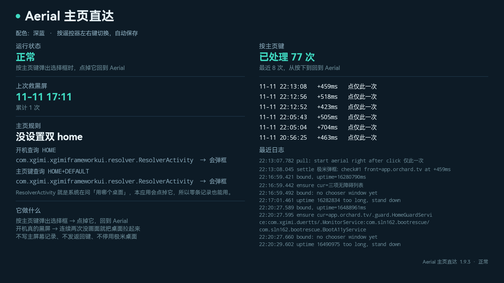

[中文](README.md) | [English](README.en.md)

# Aerial Guard (XGIMI / Android 9)

**A fallback for Aerial: bring it back when a boot ends in a black screen, or when power-on-again / wake lands on the XGIMI launcher. The "which launcher" chooser on the HOME key has been Aerial's own job since 1.97, and this service stays out of it from then on.**

On XGIMI projectors of the Android 9 firmware generation, Aerial as the launcher hits two problems: pressing HOME raises the launcher chooser and stalls for seconds; and on some boots the firmware voids the HOME record, the chooser stays in INITIALIZING without ever drawing, and the whole screen is black. The first one is solved upstream now. The second cannot be: while the screen is black Aerial never starts, so only something outside can bring it back.



## Where it stands now: step aside, then catch the fall

| Aerial version | What this service does |
|---|---|
| **≥ 1.97** | **No part in the chooser**: no clicks, no window reads, one log line and it stands down |
| **< 1.97** | The old chooser chain, unchanged (around 0.4 s) |
| any version | Boot black screen, and power-on-again / wake landing on the XGIMI launcher, are still caught here |

The reason for stepping aside is plain: upstream now answers the chooser with a Back event and puts a Home press right after it ([#1523](https://github.com/pengchujin/aerial-tv/pull/1523)); on the H3S it closes in 0.19–0.35 s and Aerial is back in 0.4–0.7 s. Our click chain is around 0.4 s. **Same order of speed, two of them make no sense — and the extra layer only takes the blame for stalls**, so from 1.97 on it steps out.

## What is still worth having

- **Boot black screen**: XGIMI voids the DEFAULT HOME record on some cold boots into `always="false"`; both HOME queries land on the XGIMI framework resolver, which stays in INITIALIZING and never draws — a black screen reachable only over network ADB. The guard is bound by then, but the user is still locked, so `onAccessibilityEvent` returns at its unlock guard. This layer pulls Aerial when nothing is on screen after the boot animation ends: 69.9 s to rescue, 73 s to the front, first frame at 77 s in the measured run.
- **Power-on-again / wake**: judged by the deep-sleep time the system itself records (even a dozen seconds counts), Aerial is brought back; an app you already opened is left alone.
- **Upstream's own locked-boot rescue is blocked on this device**: Aerial 1.97's rescue asks that the binding received no event at all, and XGIMI's boot autofocus raises a dialog that never draws (`com.xgimi.systemui` / `com.open.ui.widget.dialog.TVUIDialog`); one window event voids the condition (reported in [#1449](https://github.com/pengchujin/aerial-tv/pull/1449)). So this layer is not redundant.

## How it relates to upstream

| Upstream | State | Relation |
|---|---|---|
| [#1523](https://github.com/pengchujin/aerial-tv/pull/1523) close the chooser, then Home | in main (`e688701`) | replaces this service's chooser chain |
| [#1534](https://github.com/pengchujin/aerial-tv/pull/1534) put the dropped service back after 1.5 s | in main (`c21c8f3`) | same problem, handled upstream |
| [#1449](https://github.com/pengchujin/aerial-tv/pull/1449) start Aerial once over a locked boot | in main (`82a497a`) | upper layer; blocked on this device, covered here |
| [#1474](https://github.com/pengchujin/aerial-tv/issues/1474) | issue, open | upstream does not endorse third-party accessibility services, so this work lives here |

## When it acts

- **Boot**: after the boot animation ends, still nothing on screen and still locked — pull Aerial once; another screen visible means hands off
- **Power-on-again / wake**: on the XGIMI launcher or a black screen, bring Aerial back; an app you already opened is left alone
- **HOME key**: the chooser is clicked only when Aerial < 1.97; at ≥ 1.97 it is not touched at all
- At least 5 s between actions, at most 3 rescues per boot or wake, then it gives up

## The chooser chain's speed (1.9.22 and earlier, Aerial < 1.97 only)

20 presses, 20/20:

```
+0~1ms      click row Aerial=true
+106~126ms  click 仅此一次 (round 1)
+13ms       pull: start aerial right after click 仅此一次
+399~448ms  check#1 front=app.orchard.tv
```

The row is clicked as the chooser appears (its button lights only then), 「仅此一次」 immediately after, and Aerial is started at the same moment so it is in front before the chooser's default row (the XGIMI launcher) draws. No flash of the stock launcher.

Events are occasionally missed; a 1 s watchdog covers that, 2 of 34 measured presses took it, still under 0.5 s.

## Cost on the device

No node-tree polling. The main path is accessibility events; from 1.9.26, with Aerial ≥ 1.97 even that path is skipped and only a 1 s watchdog reads which package owns the current window (no tree walk, no subprocess, no settings writes).

Measured on the H3S (3.5 GB RAM): `0.0%` in `top` and `dumpsys cpuinfo`; 3 s of CPU over the first 7 minutes; PSS about 16 MB, 0.4%.

Against what it guards, two processes on the same screen:

| | This guard | Aerial itself |
|---|---|---|
| CPU (screen on, idle) | 0.45% of one core | 10.3% of one core |
| PSS | 16 MB | 166 MB |

About 1/23 of Aerial's CPU and 1/10 of its memory.

The honest cost: a 1 s watchdog is about 4.5 ms of CPU and keeps the CPU out of its idle state (small on a mains-powered projector); while the device really sleeps the Handler is frozen, so standby power is untouched.

## Support

The test is not a model but **whether the system raised a resolver chooser** (the XGIMI generation uses `com.xgimi.xgimiframeworkui...resolver.ResolverActivity`, AOSP uses `android/com.android.internal.app.ResolverActivity`): any firmware that raises it takes the same path.

- **XGIMI on Android 9: works** (180+ HOME presses, several reboots, several wake-ups on an H3S)
- **XGIMI on Android 11 and later: untested**. Same mechanism expected; when it cannot recognise the chooser it does nothing rather than click something else
- Other brands / AOSP: same path if the system raises the resolver; untested
- Aerial ≥ 1.97: the chooser chain is off, boot and wake fallbacks remain

## Install

1. Take the APK from [Releases](https://github.com/sln162/aerial-home/releases); if the in-place install fails, uninstall the old one first (debug signing)
2. Four adb lines:

```
pm grant com.sln162.aerialhome android.permission.WRITE_SECURE_SETTINGS
appops set com.sln162.aerialhome SYSTEM_ALERT_WINDOW allow
settings put secure enabled_accessibility_services \
  'com.xgimi.duertts/.MonitorService:app.orchard.tv/.guard.HomeGuardService:com.sln162.aerialhome/com.sln162.aerialhome.BootA11yService'
settings put secure accessibility_enabled 1
```

3. Open the app once; a green 「正常」 next to 「运行状态」 means it is running

`pm grant` is not optional: XGIMI rewrites the accessibility list at unlock and drops third-party services, and without this permission the service cannot write itself back. `appops set` is reset to `ignore` on every reinstall, so run it again after updating (the Aerial pull uses a 1 px overlay window once).

## Update

Install over the old one; no uninstall, no re-granting:

```
adb install -r AerialHome-<version>.apk
```

Open the app and check for the green 「正常」. If it is not green, toggle accessibility off and on once — the service writes itself back after XGIMI's rewrite, and only when that fails do you need to do it by hand.

A `bound, uptime=` line in the log means the system has bound the service.

## What the UI shows

| Section | Content |
|---|---|
| 运行状态 | running / not running / permissions missing |
| 上次救黑屏 | last fallback time, or 「还没发生过」 with a running count |
| 主页规则 | what the boot query and the HOME query resolve to; both being ResolverActivity reads as 「没设置双 home」 |
| 按主页键 | count, and the last 8 with time, `+Nms` and how it was handled (with Aerial ≥ 1.97 these are 「让位」 entries) |
| 最近日志 | last 10 log lines, long package names shortened |

## What it does not do

- **No HOME preferred-activity writes**, **no 「始终」**. 「始终」 writes the default row (the XGIMI launcher); clicking the row or using `ACTION_SELECT` are not clean either
- **Never above upstream**: with Aerial ≥ 1.97 it touches nothing and leaves the chooser to Aerial
- **No Back-event stealing**: a Back always goes to the focused window and would land on the app you pressed HOME in (this case is upstream's own from 1.97 on)
- **No freezing or disabling of the stock launcher**, no changes to system components
- **No guessing when a button cannot be identified**. Closing the chooser with 「取消」 and pulling Aerial again beats betting on position or order

## Limits

- Only run on XGIMI Android 9 firmware; later versions untested
- After 「仅此一次」 the chooser starts its default row (the XGIMI launcher) and Aerial is started right after to cover it; that relies on the accessibility service's background-start exemption
- Occasionally 0.6 s to arrive; on a freshly booted device, while the accessibility list is being rewritten, a little over 1 s
- Once Aerial covers the chooser, its nodes leave `getWindows()`, hence the action runs inside the event

## Log

```
adb shell run-as com.sln162.aerialhome cat /data/user_de/0/com.sln162.aerialhome/files/rescue.log
```
