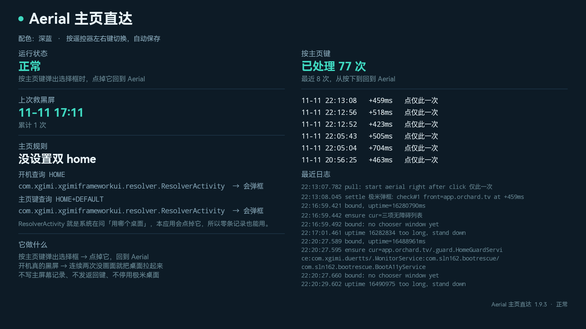

[中文](README.md) | [English](README.en.md)

# Aerial 守护（极米 / Android 9）

**给 Aerial 兜底：开机黑屏、关机再开或睡醒的第一帧落在极米桌面时，把它请回来。按主页键的「用哪个桌面」弹框，Aerial 1.97 起已经自己能处理，这个服务从那时起不再插手。**

极米投影仪（Android 9 那一代固件）把 Aerial 当桌面用时有两类毛病：按主页键先弹选择框，卡几秒才回来；开机时首选记录被固件作废，选择框停在初始化、整屏黑。第一类已经在上游解决，第二类上游管不到——黑屏时 Aerial 根本没起来，只能由外面兜。



## 现在的定位：先让位，再兜底

| Aerial 版本 | 这个服务做什么 |
|---|---|
| **≥ 1.97** | **完全不参与点框**：不点、不读窗口，只写一行日志就退出 |
| **< 1.97** | 点框链照旧（1.9.22 那一套，0.4 秒量级） |
| 任何版本 | 开机黑屏、关机再开/睡醒落到极米桌面，仍然由它兜 |

让位的原因很直白：上游现在是在弹框出现时先发一个返回键把它关掉，再补一次主页键（[#1523](https://github.com/pengchujin/aerial-tv/pull/1523)），H3S 上实测 0.19–0.35 秒关框、0.4–0.7 秒回到 Aerial；我们点框链是 0.4 秒上下。**两条路速度在同一量级，两份都做没有意义，留着反而给卡顿背锅**，所以从 1.97 起这层退出去。

## 还剩下什么用

- **开机黑屏**：极米会在某次冷启动里把带 DEFAULT 的首选记录作废成 `always="false"`，两种 HOME 查询都落到极米框架的选择器，而选择器停在 INITIALIZING 画不出来——整屏黑，只有网络 ADB 能连。守護这时已经绑定，但用户没解锁，事件处理在解锁检查处直接返回。这一层在开机动画收掉后仍看不到界面时把它拉起来：实测 uptime 69.9 秒救援、73 秒到前台、77 秒画出第一帧。
- **关机再开 / 睡醒第一帧落在极米桌面**：按系统自己记账的休眠时长判断（睡十几秒也认），直接把 Aerial 请回来；你已经开起别的 app 就不抢。
- **上游的锁屏兜底在极米这台会被挡**：Aerial 1.97 的锁屏兜底要求「这次绑定一个事件都没收到」，而极米开机自动对焦会先弹一个从不绘制的对话框（`com.xgimi.systemui` / `com.open.ui.widget.dialog.TVUIDialog`），一条窗口事件就把条件废掉（已报在 [#1449](https://github.com/pengchujin/aerial-tv/pull/1449)）。所以外面这一层不是多余。

## 和上游的关系

| 上游 | 状态 | 与本项目的关系 |
|---|---|---|
| [#1523](https://github.com/pengchujin/aerial-tv/pull/1523) 先关弹框再补一次 HOME | 已并入 main（`e688701`） | 取代了本服务的点框链 |
| [#1534](https://github.com/pengchujin/aerial-tv/pull/1534) 被固件删掉 1.5 秒后补回 | 已并入 main（`c21c8f3`） | 与本服务同源的问题，交给上游处理 |
| [#1449](https://github.com/pengchujin/aerial-tv/pull/1449) 锁屏期兜一次 | 已并入 main（`82a497a`） | 上层兜底；极米这台被对焦框挡住，本服务补这一块 |
| [#1474](https://github.com/pengchujin/aerial-tv/issues/1474) | Issue，讨论中 | 上游不背书第三方无障碍服务，所以这类活留在本仓库 |

## 它什么时候动手

- **开机**：开机动画收掉后仍看不到界面、也一直没被解锁，就拉一次 Aerial；看得见别的界面就不动
- **关机再开 / 睡醒**：落在极米桌面或整屏黑，把 Aerial 请回来；你已经开起别的 app 就不抢
- **按主页键**：只在 Aerial < 1.97 时点框；≥ 1.97 一概不碰
- 两次动作至少隔 5 秒，一次开机或一次唤醒最多救 3 次，救不起来就收手

## 点框链有多快（1.9.22 及更早，只对 Aerial < 1.97 生效）

20 连按 20/20：

```
+0~1ms      click row Aerial=true
+106~126ms  click 仅此一次 (round 1)
+13ms       pull: start aerial right after click 仅此一次
+399~448ms  check#1 front=app.orchard.tv
```

弹框一出现就点中 Aerial 那一行（按钮这时才亮），亮了立刻点「仅此一次」，同一时刻自己把 Aerial 拉起来，抢在弹框默认候选（极米桌面）画出来之前。屏幕上不会看到极米桌面闪一下。

事件偶尔会漏，另有 1 秒一次的巡检补一次，实测 34 次里 2 次走这条路，同样 0.5 秒内到站。

## 对机器的影响

不靠定时扫节点。主路径是无障礙事件，框一出现就动手；1.9.26 起 Aerial ≥ 1.97 时连这条路都不走，只剩一个 1 秒一次的看门狗读一次「当前窗口属于哪个包」（不遍历节点树、不起子进程、不读写系统设置）。

实测（极米 H3S，总内存 3.5 GB）：`top` 和 `dumpsys cpuinfo` 里常显 `0.0%`；装完头 7 分钟累计 CPU 只有 3 秒；内存 PSS 约 16 MB，占 0.4%。

和它要守护的对象比，同一块屏幕上量的两个进程：

| | 这个守护 | Aerial 自己 |
|---|---|---|
| CPU（亮屏待机） | 0.45% 单核 | 10.3% 单核 |
| 内存 PSS | 16 MB | 166 MB |

也就是它只占 Aerial 的 1/23 CPU、1/10 内存。

需要说清的代价：每秒一次看门狗 ≈ 4.5 毫秒 CPU，会打断 CPU 的空闲态（对插电的投影影响很小）；设备真睡着时 Handler 被冻住，不再消耗，所以待机功耗不受影响。

## 支持范围

判据不是机型，是**系统弹的是不是个 resolver 选择框**（极米这一代是 `com.xgimi.xgimiframeworkui...resolver.ResolverActivity`，AOSP 是 `android/com.android.internal.app.ResolverActivity`）：只要走的是它，跟机型无关。

- **Android 9 极米：实测可用**（H3S 上跑了 180 多次按主页键、多次重启、多次关机唤醒）
- **Android 11 及更新的极米：未实测**。机制一样（resolver + 无障碍点节点），预计可用；认不出来时退化成不动手，不会乱点别的窗口
- 其他品牌 / AOSP：只要弹的是系统 resolver 就走同一条路径，未实测
- Aerial ≥ 1.97：点框链不启用，只剩开机与唤醒兜底

## 装法

1. 从 [Releases](https://github.com/sln162/aerial-home/releases) 下 APK，覆盖安装失败就先卸载旧的（调试签名）
2. adb 四条：

```
pm grant com.sln162.aerialhome android.permission.WRITE_SECURE_SETTINGS
appops set com.sln162.aerialhome SYSTEM_ALERT_WINDOW allow
settings put secure enabled_accessibility_services \
  'com.xgimi.duertts/.MonitorService:app.orchard.tv/.guard.HomeGuardService:com.sln162.aerialhome/com.sln162.aerialhome.BootA11yService'
settings put secure accessibility_enabled 1
```

3. 打开一次应用，「运行状态」显示绿色「正常」就成了

`pm grant` 不是可选项：极米在解锁那一刻会重写无障碍列表，把第三方服务剔掉，没有这个权限服务写不回去。`appops set` 每次覆盖安装后会被系统重置成 `ignore`，装机后请重新执行一次（拉 Aerial 时要用一次 1px 覆盖窗口）。

## 怎么更新

覆盖安装就行，不用卸载、不用重新授权：

```
adb install -r AerialHome-<新版本>.apk
```

装完打开应用，看「运行状态」是不是绿色「正常」。不是的话，把无障碍开关关一下再开——极米解锁时会重写无障碍列表，服务自己会补回去，补不回来才需要手动开一次。

日志里有 `bound, uptime=` 一行，就说明服务已经被系统绑上了。

## 界面看什么

| 区块 | 内容 |
|---|---|
| 运行状态 | 正常 / 未运行 / 权限不全 |
| 上次救黑屏 | 最近一次兜底的时间；没发生就是「还没发生过」，下面是累计次数 |
| 主页规则 | 开机查询、主页键查询各自解析到谁，两处都是 ResolverActivity 就写「没设置双 home」 |
| 按主页键 | 累计次数；最近 8 次带时间、`+Nms`、怎么处理的（Aerial ≥ 1.97 时这里只有「让位」记录） |
| 最近日志 | 日志末 10 行，长包名压成「极米弹框」「三项无障碍列表」 |

## 它不做什么

- **不写 HOME 首选记录**，**不点「始终」**。这个弹框里「始终」写进的是默认选中那一行（极米桌面）；点候选行、`ACTION_SELECT` 都不是干净的做法
- **不超过上游**：Aerial ≥ 1.97 时一行不碰，弹框留给 Aerial 自己关
- **不发返回键抢活**：返回键永远发给当前焦点窗口，在第三方 app 里按主页键时会落到那个 app 身上（这条只在 Aerial ≥ 1.97 时由上游自己处理）
- **不冻结、不禁用极米自带桌面**，不动系统组件
- **认不出按钮就不猜**。宁可点「取消」把框关掉、自己再拉一次，也不按位置或顺序赌哪个是「仅此一次」

## 局限

- 只在 Android 9 极米固件上跑过，更高版本未实测
- 选「仅此一次」之后弹框会启动默认那一行（极米桌面），我们紧接着自己拉起 Aerial 盖掉；这一步靠无障碍服务的后台启动豁免
- 个别时候到站 0.6 秒；开机刚起来那一阵系统忙着重写无障碍列表，会到 1 秒出头
- 弹框被 Aerial 完整盖住后节点就从 `getWindows()` 里消失，所以动作放在事件里执行

## 日志

```
adb shell run-as com.sln162.aerialhome cat /data/user_de/0/com.sln162.aerialhome/files/rescue.log
```
